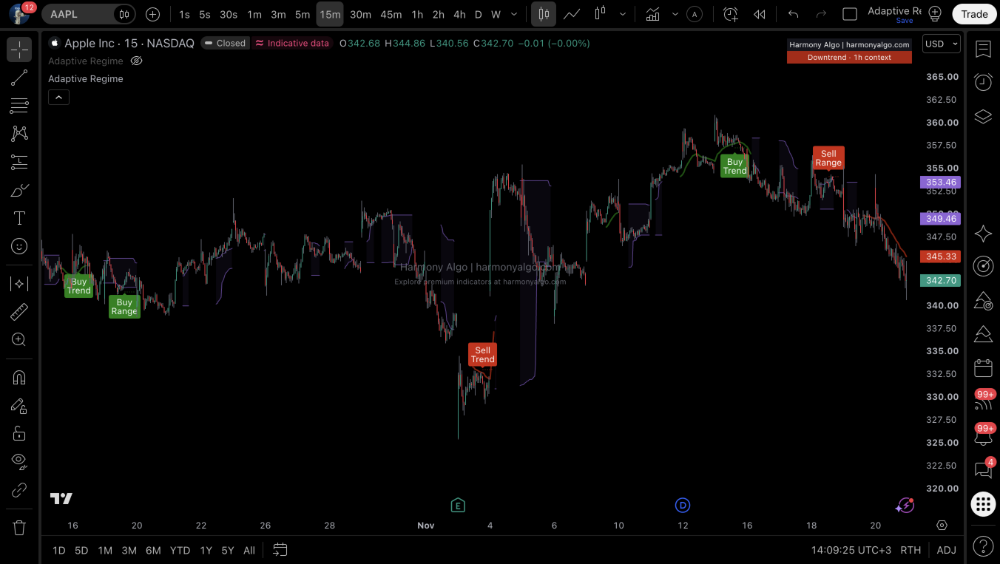
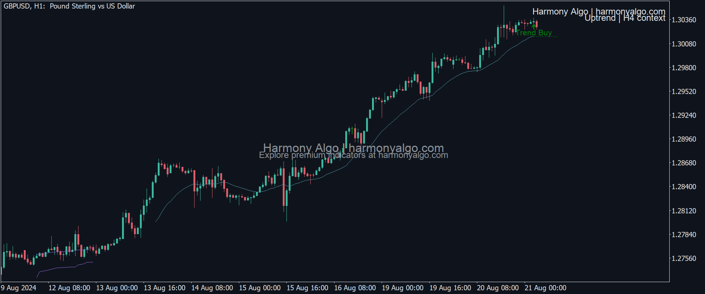

# Adaptive Regime Signals [Harmony Algo]

A free indicator for confirmed failed range breaks and structural trend pullbacks. The chart badge identifies the active regime. The dotted segment marks the fixed setup invalidation.

## TradingView

Open the Community TXT or Pine file, paste it into Pine Editor and add it to a standard time-based candle chart. Use the optional guide, invalidation and status toggles to control the chart overlays. The Community watermark stays on the chart. The clean open-source publication is [on TradingView](https://www.tradingview.com/script/SVmBbOGX-Adaptive-Regime-Signals-Harmony-Algo/).

Range signals need repeated reactions at both edges and confirmation back into the range with room to its midpoint. Trend signals follow a protected swing and a confirmed pullback break. Intraday trend context uses completed higher-timeframe candles. The four signal types can be selected independently when creating an alert. Marks appear on the confirming close. Signals can be sparse and are not forecasts.

The Community and clean TradingView scripts matched across 2,090 closed bars on BTCUSDT 5m, EURUSD 1W and AAPL 15m, including ten signals and their alert flags. This comparison does not test delivery of notifications or trading outcomes.

The watermark identifies the author and can be removed by editing the open source. The premium indicators currently offered are for TradingView. See [LICENSE.md](LICENSE.md).

## MetaTrader 5

Install the EX5 in MT5 via **File → Open Data Folder → MQL5 → Indicators**. Refresh Navigator and add the indicator to a standard time-based chart. The MQ5 is also supplied for inspection and recompilation. Terminal alerts and push notifications are separate settings and both default to off. Push delivery requires terminal configuration.

MetaEditor compiled with zero errors and warnings. Closed-bar event codes, chart markers and alert conditions were checked on EURUSD M15, GBPUSD H1 and EURUSD H4 using 9,471 buffer rows, including three open bars that emitted no signal. The 39 closed signals matched the clean MQL5 build. An isolated D1 replay checked open-bar changes, new history and reinitialization. No test notification was sent.

Broker sessions, prices, tick sizes and higher-timeframe boundaries can differ from TradingView. MT5 draws two range edges and uses native arrows and text. Signals were compared between the Community and clean MQL5 builds on the same broker data. Cross-provider, bar-for-bar Pine versus MT5 equivalence was not established. The watermark promotes TradingView premium indicators.
