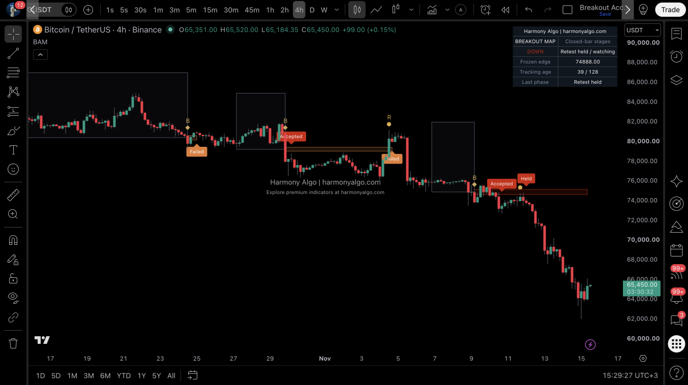

# Breakout Acceptance Map Community [Harmony Algo]

A fixed-range chart overlay that follows a breakout through acceptance, a later retest, a reclaim and possible failure. It supplies context, not trade orders or a profitability forecast.

[Original open-source TradingView publication](https://www.tradingview.com/script/F4wMKWbW-Breakout-Acceptance-Map-Harmony-Algo/) · [Harmony Algo](https://harmonyalgo.com)

*Actual TradingView Community render, Binance BTCUSDT 4h, 15 November 2026. This is not an MT5 screenshot or an MT5 test result.*

## Method and chart interpretation

The previous 64 candles define a wick-high/wick-low reference. A range qualifies when its width is 2.5–8 previous ATR(21), its close-path efficiency is at most 0.35, and the current confirmed close remains inside. Efficiency is absolute net closing-price change divided by the sum of absolute closing-price changes. Both boundaries and the ATR scale then freeze. The grey box begins at detection, not at the start of its historical reference window.

- **B / amber diamond:** a confirmed close more than 0.30 frozen ATR beyond an edge. Acceptance is pending.
- **Accepted:** three consecutive closes more than 0.10 ATR outside. The breakout candle can be the first close; the acceptance window is 12 breakout bars.
- **R / amber circle:** a later candle intersects the edge band after a previously confirmed candle has travelled at least 1.25 ATR outside. The band is +/-0.25 ATR.
- **Held:** a subsequent close reclaims the original retest candle extreme by more than 0.05 ATR and is still beyond the acceptance buffer.
- **Failed:** two consecutive closes more than 0.15 ATR back inside, or one close through the opposite range boundary. Failure is monitored even after Accepted or Held. It is not an opposite-direction entry signal.

The first qualifying retest and reclaim are followed; repeated touches do not create repeated Held labels. An armed range expires after 96 bars. A breakout is observed for at most 128 bars, with 12 complete bars between ranges. Timeout ends observation without assigning a winning or losing trade.

## Settings

| Pine setting / MT5 equivalent | Default | Purpose |
|---|---:|---|
| Reference bars / ReferenceBars | 64 | Prior-bar reference horizon |
| ATR length / ATRLength | 21 | Wilder volatility scale |
| Maximum range width / MaximumRangeATR | 8.0 ATR | Range width ceiling; fixed minimum 2.5 ATR |
| Maximum directional efficiency / MaximumEfficiency | 0.35 | Less directional range gate |
| Armed range lifetime / ArmedLifetime | 96 | Maximum wait for breakout |
| Breakout buffer / BreakoutBufferATR | 0.30 ATR | Closing breakout distance |
| Outside closes / AcceptanceCloses | 3 | Acceptance persistence |
| Acceptance window / AcceptanceWindow | 12 | Includes breakout candle |
| Retest half-width / RetestHalfWidthATR | 0.25 ATR | Frozen edge band |
| Travel before retest / TravelBeforeRetestATR | 1.25 ATR | Earlier confirmed travel required |
| Total tracking / TrackingBars | 128 | Breakout observation horizon |
| Full bars between ranges / CooldownBars | 12 | Re-arming separation |
| Ranges retained / RangesRetained | 12 | Range/edge drawing history |
| Show stages / ShowStages | true | B/R markers |
| Show panel / ShowSummary | true | State summary |
| Bull / bear colors | green / red | Directional display |
| MT5 EnablePopupAlerts | false | Optional local alerts, new closed bar only |

## TradingView installation and alerts

1. Open `BreakoutAcceptanceMap-Community.pine` or its identical UTF-8 `.txt` copy.
2. Create a new indicator in Pine Editor, paste the complete source, save and add it to standard time-based candles.
3. Choose the required alert condition: breakout, bullish/bearish acceptance, retest, bullish/bearish Held, failure, or observation-window end. Use once per bar close.

The Community source has permanent central and panel branding, with no watermark-hide input. Branding does not control calculations or alerts. Open source can be edited, including removing branding; this is not copy protection. The original public TradingView source is clean and is not overwritten by this Community variant.

## MetaTrader 5 — UNCOMPILED / UNTESTED SOURCE

`BreakoutAcceptanceMap-Community-MT5.mq5` is an experimental source port. **No MetaEditor compilation, MT5 chart run, live popup delivery, or numerical Pine/MT5 comparison has been verified. No .ex5 is supplied.**

Place it in `MQL5/Indicators`, open it in MetaEditor, run Styler, compile, inspect all compiler output, then test on a standard demo chart before use. Do not assume successful compilation or operation from the presence of a source file.

The port implements the same default range criteria, frozen boundaries/ATR, closing confirmations, retest/reclaim/failure logic, finite windows and cooldown. It uses an initial SMA ATR seed followed by Wilder recurrence. Closed history is rebuilt on each new bar; performance has not been profiled. The unfinished bar carries committed state and no event flag. Enabled popup alerts report only the latest newly closed bar after a live tick; attaching the indicator does not replay historical alerts. These are local terminal alerts, not TradingView server alerts.

Display differences: MT5 uses unfilled rectangle outlines, arrow/glyph buffers and colored text instead of transparent Pine bands and filled label boxes. B/R glyph placement is an approximate presentation equivalent. The summary panel shows current/last phase; frozen edge, state, direction and event mask are available in Data Window. Central branding uses screen labels and has resize handling, which has not been chart-tested. The last 500 main event markers are drawn, while diagnostic event history remains available.

Broker feeds, sessions, candle alignment, gaps and available history can change results. No volume or multi-timeframe data are used. Identical signals across platforms have not been established. A separate ad-free CodeBase derivative is being kept as a draft until that platform's formatting and genuine-chart-image requirements can be met; this GitHub source remains branded.

## Verification and limits

- Approved clean Pine: zero editor diagnostics; 16 synthetic/adversarial tests, including 200 mirrored random paths, passed. An independent lifecycle replay matched 629 synchronized closed bars and eight alert conditions across BTCUSDT 1h/4h, EURUSD 4h and AAPL 1h. Incomplete initial lifecycles were excluded until an observed new range; ATR recurrence used a chart-provided starting value. This is implementation QA, not a performance backtest.
- Community Pine: compiled with no editor diagnostics and ready chart status. All 400 loaded rows and 22 columns, including time, plots, diagnostics and actual alert booleans, matched the approved clean script on BTCUSDT 4h. The final standalone Community chart was inspected after a timeframe recalculation; central branding and the panel header were readable and separate.
- MT5: static source/default/buffer/closed-bar review only. No compiled or terminal-tested result is claimed. CodeBase validation has not started.

All signals require closing evidence and can arrive late. A trend can continue without a range or retest. Closing failure does not simulate intrabar stops. Labels are event markers, not execution prices. A whole zone's color reflects its latest stage and can recolor earlier parts of the zone; historical event labels remain at their knowledge bars. Available history and data corrections can change historical readings. Profitability, full tick replay, actual server-alert delivery and history-depth invariance are unverified.

## License and provenance

Copyright (c) 2026 Harmony Algo. Mozilla Public License 2.0; see `LICENSE.md`. Source hashes and separate test status are in `Verification.txt` and `SHA256SUMS.txt`. No premium/private source is included.

Explore [Harmony Algo](https://harmonyalgo.com). The existing premium product is for TradingView; no premium MT5 product is promised.
