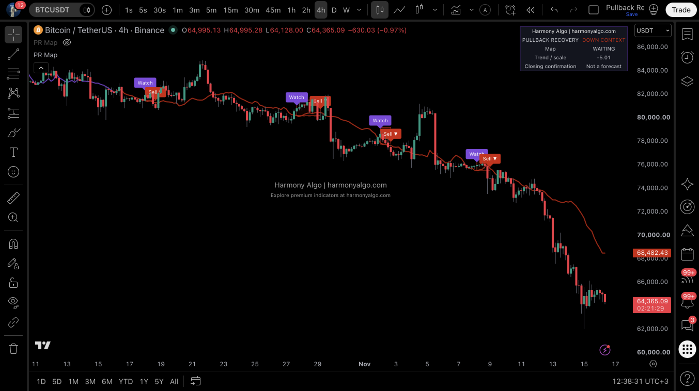

# Pullback Recovery Map Community [Harmony Algo]

A robust trend-context overlay that follows a pullback through a fixed Watch map, closing recovery, loss of its frozen guard, or cancellation. It describes price structure; it is not a trading system or profitability forecast.

[Original clean open-source TradingView publication](https://www.tradingview.com/script/5vYbkMqc-Pullback-Recovery-Map-Harmony-Algo/) · [Harmony Algo](https://harmonyalgo.com)

Actual TradingView Community screenshot, 16 November 2026. This is not an MT5 screenshot or terminal test.

## Method

The default 96 prior closes exclude the decision candle. Eight 12-bar mean prices produce 28 pairwise slopes at their original segment-center times; their median and a median intercept define the baseline, evaluated one bar past the last input close. Scale is the larger of prior ATR(21) and 1.4826 times the median absolute segment residual. This is a block-aggregated median-pair fit, not exact raw-price Theil-Sen, probability or a confidence interval.

Direction requires a 2.5-scale fitted move for three closes; release requires signed movement at or below 0.8 scale for three closes. After six bars of context, price must first close 0.5 scale on its favorable side. A later close 0.5–1.75 scales against the baseline starts Watch. Baseline, scale, guard, and recovery threshold then freeze.

Recovery is beyond both the initiating candle extreme and 0.15 scale on the favorable side of the frozen baseline. At least three bars must elapse; two consecutive closes beyond recovery produce Buy or Sell. Two closes through the guard produce Lost. Direction loss or 48-bar expiry produces End. Priority: failure, context loss, recovery, expiry. Rearming needs a 12-bar cooldown and fresh favorable progress.

## Chart and alerts

- Green/red/purple rolling baseline: upward/downward/mixed trend context.
- Box: frozen baseline-to-guard area; dashed line: fixed recovery threshold.
- Watch: unresolved pullback. Buy/Sell: closing recovery condition, not an order or recommendation.
- Lost: two closing guard breaches. End: cancelled/expired attempt.

Map objects recolor when their outcome becomes known; earlier parts of that same box therefore show its final result. Event labels remain on the actual closing confirmation bar. Completed maps stop monitoring and can fail later without restarting.

Pine alert conditions: Pullback watch, Upward recovery, Downward recovery, Frozen guard lost, Map ended. Create an alert with closing-bar frequency. MT5 offers an optional popup alert, off by default, for the latest newly completed bar; no historical alert burst is intended.

## Settings

| Pine / MT5 input | Default | Purpose |
|---|---:|---|
| Bars per trend segment / BarsPerSegment | 12 | Eight segments, 96 prior bars |
| Trend entry / TrendEntryScale | 2.5 | Fitted movement divided by model scale |
| Trend release / TrendReleaseScale | 0.8 | Three-close directional release |
| Pullback trigger / PullbackTriggerScale | 0.5 | Adverse depth to begin watching |
| Frozen guard distance / GuardDistanceScale | 1.75 | Guard distance fixed at Watch |
| Maximum tracking bars / MaximumTrackingBars | 48 | Expiry after Watch |
| Show summary / ShowSummary | true | Optional status panel |
| Retained maps / RetainedMaps | 80 | Historical drawing retention |

Three-close direction persistence, six-bar context age, two-close recovery/failure, minimum recovery age three, cooldown twelve, ATR length 21, favorable arming 0.5 scale and recovery padding 0.15 scale are fixed in both sources. Community branding has no hide input. Since the sources are open, users can edit the branding; it is not copy protection and does not control calculations.

## Install

TradingView: open Pine Editor, create a new indicator, paste the complete `.pine` or matching UTF-8 `.txt`, save and add to a standard-candle chart. The public TradingView link above opens the clean publication; these downloadable Community files include branding.

MT5 experimental source: copy `.mq5` into MQL5/Indicators, open in MetaEditor, compile, inspect warnings/errors, then validate on an MT5 chart. This port has NOT been compiled or terminal-tested. No `.ex5` is supplied. Do not treat the extension or static checks as proof that it runs.

## Separate validation status

Pine clean source: compiled and visually checked on BTCUSDT 4h/1h, AAPL 1h (BATS feed), EURUSD 4h. Independent model checks matched 4,312 calculation bars and 4,117 state bars; 21 Python contract checks passed. These are implementation checks, not a trading backtest.

Pine Community: compiled, chart ready status; all 400 loaded rows and all plotted/diagnostic/alert columns matched the approved clean script exactly. Central branding and panel header were visually checked without hiding signals. The clean review chart was restored afterward. Published clean source readback hash matches the approved source.

MT5: source structure/defaults/buffer mappings and closed-bar logic reviewed only. Compiler and terminal are unavailable on this host; cross-platform numerical parity, actual rendering and popup delivery are unverified. CodeBase distribution remains blocked pending compilation and genuine MT5 chart verification. No public CodeBase URL exists for this product.

## Platform differences and limitations

MT5 uses broker OHLC/history and Wilder ATR initialized from its available history. TradingView and MT5 can differ in sessions, gaps, time zones, adjustment conventions, tick construction and initial history. No volume or MTF data is used. The MT5 port rebuilds calculations/objects on new bars, uses segmented colored baseline buffers and text/arrow markers; box fill and Pine label shapes are not pixel-identical. Large histories may be expensive. Do not assume equal signals across feeds.

Closing confirmation and wide context add lag. Gaps, curvature, several abnormal segments and regime shifts can invalidate a map. In development observations, some recovered maps crossed their original guard within later bars; recovery is not a guarantee. The guard is not a recommended stop. Fees, slippage, execution, profitability and real alert delivery are untested. Historical data corrections and dataset start changes can alter results.

## License and provenance

Original source, copyright (c) 2026 Harmony Algo, Mozilla Public License 2.0. See LICENSE.md and Verification.txt. No premium/private source or credentials are included.

Explore [Harmony Algo](https://harmonyalgo.com). The existing premium product is for TradingView; no premium MT5 product is promised.
